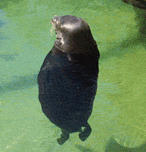
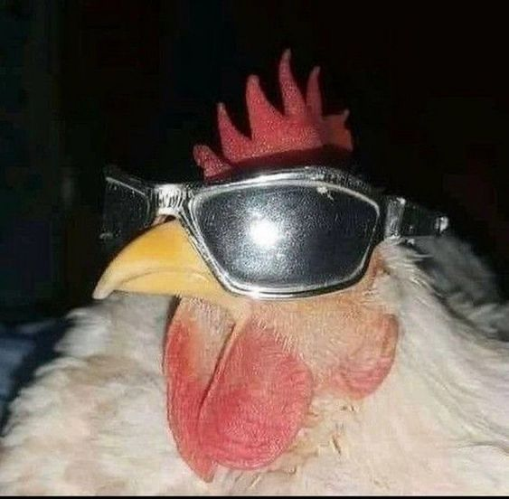

# Matteo Giorgetti (aka Inventure71)

---

### 👋 About Me
- **CS & AI Student** @ IE University
- Real gamer and F1 fan
- Passionate about **game development**, **AI tools**, and creative coding projects
- Experienced with **Python**, **Swift/SwiftUI**, **JavaScript**, and **Unreal Engine**
- Powered by RedBull and Beer, always exploring new tech and ideas
- Enjoys kitesurfing and coding random projects in my free time

---

## Projects

- **[VIGIL](https://github.com/Inventure71/VIGIL)** — Robot fleet dashboard for monitoring, SSH access, diagnostics, and recovery
- **[Dream2Detect](https://github.com/Inventure71/Dream2Detect)** — Experiments in synthetic-to-real generalization for package defect detection
- **[PaddockJS](https://github.com/Inventure71/PaddockJS)** — Embeddable JavaScript racing simulator with browser and headless APIs
- **[ClipClop](https://github.com/Inventure71/ClipClop)** — Clipboard sync with QR pairing and encrypted configuration
- **[GenGame – Core Conflict](https://github.com/Inventure71/GenGame)** — Python multiplayer arena and game framework
- **[Neural Noir](https://github.com/Inventure71/Neural-Noir)** — Procedural AI-driven narrative experiment  
- **[HoloVinyl](https://github.com/Inventure71/HoloVinyl)** — Computer vision gesture controller for touchless UI  
- **[VictorIA](https://github.com/Inventure71/VictorIA)** — Game AI perception + decision-making system  
- **[AlgorithmsProject](https://github.com/Inventure72/AlgorithmsProject)** — Python/Pygame strategy game with deck building, troop placement, and a bot opponent
- **[TypeCraft](https://github.com/Inventure71/TypeCraft)** — Human typing simulator for macOS
- **[GDG Website](https://github.com/GDSC-IE/GDG_Hackathon_Website)** — GDG hackathon website

### Coursework & earlier research

Course assignments, exercises, and study material live on **[Inventure72](https://github.com/Inventure72)**. My [portfolio](https://mgiorgetti.com) brings selected work from both accounts together.

My earlier [IB Extended Essay](https://github.com/Inventure71/Extended_Essay) explores how neural-network size affects performance across different tasks.

---

### Tech Stack
Here are some of the tools I use:

  
  
  
  
  

---

### GitHub Stats & Trophies

  
  
   
  
   
  

---

---

  <h3>Tools & Concepts I’m Exploring</h3>
  
<strong>Advanced AI Prompt Engineering</strong> for more intuitive interactions

  
<strong>Computer Vision</strong> to analyze and interpret visual data

  
<strong>RAG Methods</strong> for robust knowledge retrieval

  
<strong>Siamese Networks</strong> for handwriting recognition

---

  <h3>Connect with Me</h3>
  
  
  

